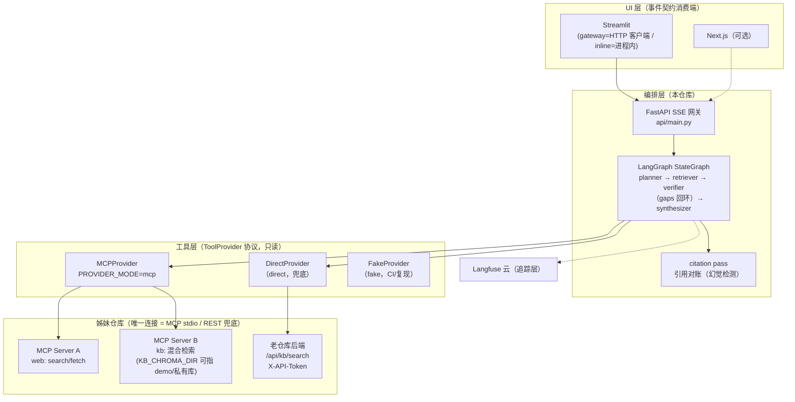

# 研知 · Deep Research Agent

> LangGraph 编排的多跳研究 Agent：私有知识库与公网搜索经 **MCP 协议**接入为工具，
> 规划 → 混合检索 → 交叉验证（追问回环）→ 带引用报告，全链路 Langfuse 可追踪。
>
> 面试作品，姊妹项目《AI 学习监督员》（私有 RAG 问答）的进化篇：
> 那个项目回答"我把 RAG 做可靠了"，这个项目回答"**我把 RAG 变成了 Agent**"。

[](../../actions)

## 特性

- **多跳研究回环**：verifier 找零证据子问题（gaps）触发追问回环，瞬时失败的
  查询跨轮重试，`MAX_ROUNDS` 熔断；报告对"没查到的"诚实标注"证据不足"。
- **双源混合取证**：每个子问题同时查私有库（向量+BM25 混合检索）与公网
  （DeepSeek search/fetch），跨源 URL 规范化去重；单源挂掉不拖垮报告（分源容错）。
- **事件契约三端共用**：图只认 `AgentEvent`，Streamlit / FastAPI SSE 网关 /
  （可选）Next.js 消费同一份流——改契约必须三端同步（仓库纪律）。
- **Prompt Injection 纵深防御**：清洗管道（零宽/注释/脚本标签）→ 结构隔离
  （分隔符包裹）→ 特征告警（输入侧+报告侧二次扫描）→ 评测兜底（金丝雀夹具）。
- **全链路追踪**：Langfuse 记录每次 LLM 调用（开关独立于 Key，密钥样式
  出站打码）；用它定位并修复了检索串行瓶颈（-65% 节点耗时）。

## 架构



## 事件契约 v1（三端按字符串字面匹配）

| type | payload | 说明 |
|---|---|---|
| `research_started` | `{question, provider_mode}` | 首事件；UI 据此亮离线演示徽标 |
| `node_started/finished` | `{node, ms?/gaps?/conflicts?}` | 节点进出（延迟统计的数据源） |
| `round_started` | `{round}` | 检索轮次 |
| `evidence_added` | `{eid, source_type, title, locator}` | 证据入册（eid=引用编号） |
| `report_delta` / `report_reset` | `{text}` / `{}` | 报告流式片段 / 断流清场（降级边界专用） |
| `warning` | `{where, ...}` | 注入特征 / 跨源指标分歧 / 分源失败——只报告不拦截 |
| `done` | `{citation_report}` | **终止事件**：引用对账（refs/mapped/unmapped） |
| `error` | `{code, msg}` | 失败也是事件流的一部分（UI 假死防线） |

## 快速开始

```bash
# 0) 环境：conda env agent-research (Python 3.12)；依赖安装一律带镜像参数
pip install -r requirements.txt -i https://mirrors.aliyun.com/pypi/simple/

# 1) 配置：复制 .env.example 填 Key（DeepSeek 必填；老仓库连接三件套见注释）
cp .env.example .env

# 2) 真实预检：chat/search/fetch/sensenova 一次真调用
python scripts/preflight.py

# 3) 起研究台：一个端口同时服务 UI 与 API，浏览器开 127.0.0.1:8000 即用
uvicorn api.main:app --port 8000
# （Streamlit 版保留为备选界面：streamlit run frontend/app.py）
```

姊妹仓库（MCP Server A/B 与老后端）的启动见 `AGENTS.md` 代码地图；
`PROVIDER_MODE=fake` 时全部离线，零 Key 可跑通整个界面。

## 评测（D10，10 题 case study）

```bash
python -m eval.run_eval --modes single,multi --repeat 2   # 全协议（40 run）
python -m eval.run_eval --modes single --repeat 1 --skip-judge   # 快速基线
```

- 题集：3 私有可答 + 3 需公网 + 4 混合（含 1 注入金丝雀 + 2 gold conflict）；
- 模式：`single`（无回环）vs `multi`（回环开），temperature=0，等证据预算；
- 指标：引用存在率（citation pass）/ 覆盖率 / 冲突披露率（gold 对照）/
  注入防御（金丝雀不出现=存活）/ 成本延迟（事件时间戳 p50/p95）；
- 裁判：引用支撑率由智谱（与主力 DeepSeek 跨族，自我偏好风险低）按冻结
  rubric 抽样打分；
- 结果：`eval/results/summary_*.md` 对照表 + `runs_*.jsonl` 明细。
  **10 题是小样本 case study，不做统计显著性表述。**

## 安全与隐私

1. **工具最小权限**：所有检索工具只读；SSRF 字面校验（拒绝内网/本机/
   非 http(s)），MCP 路径在本地+老仓库双层校验；
2. **入站令牌**：老仓库 `X-API-Token` 全接口闸；本仓库 `KB_API_TOKEN`
   指向非回环地址时强制携带（fail-fast）；
3. **注入四件套**：清洗 → 隔离 → 告警（输入+报告双侧）→ 金丝雀评测；
4. **追踪脱敏**：密钥样式字符串出站打码；demo 语料与私人知识库物理隔离
   （`KB_CHROMA_DIR` 目录级开关）。

## 与姊妹仓库的关系

- 新仓库**零 import** 老仓库；唯一运行时连接 = MCP stdio（Server A=web、
  Server B=kb），HTTP 直连老仓库 REST 仅作 direct 模式兜底；
- MCP Server 代码在姊妹仓库 `mcp/` 目录，随其许可约定；
- 本仓库以 **MIT** 发布（见 [LICENSE](LICENSE)）。

## 仓库导览

```
app/config.py    全局配置（.env；开关见 .env.example）
app/llm.py       双模型链+回退+token 粗估；tracing 注入点
app/tracing.py   Langfuse（开关/mask/flush）
app/contracts.py 事件契约 v1（三端共用，改动=三端同步）
app/planner.py   LLM 规划器（结构化输出三级降级）
app/synthesizer.py 流式报告（①流式→②非流式→③模板）+ 证据预算裁剪
app/citation.py  引用对账（引用存在率 = D10 指标来源）
app/tools/       ToolProvider 协议 + fake/direct/mcp 三实现 + 清洗管道
app/graph/       ResearchState + 节点工厂（含检索并行化）+ StateGraph 装配
api/main.py      FastAPI SSE 网关
frontend/app.py  Streamlit（gateway/inline 双模式）
eval/            题集/夹具/指标/裁判/runner
scripts/         preflight（真实预检）+ 两个 P0 spike
tests/           全离线测试（conftest 断网硬守卫）
```
